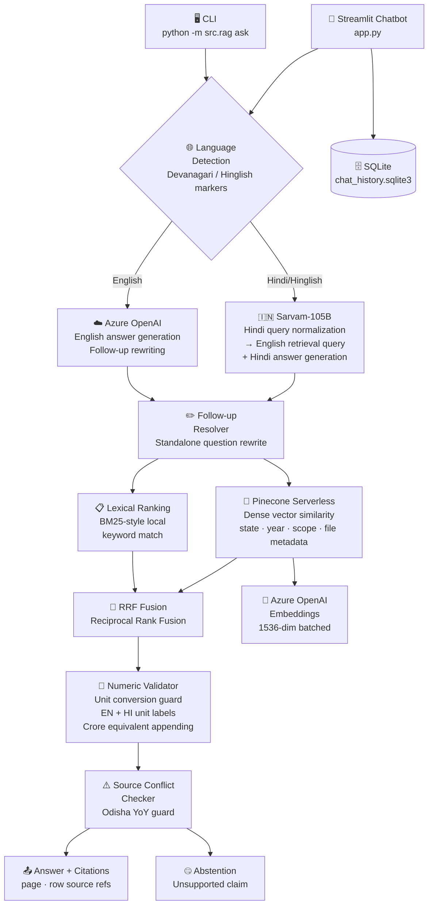
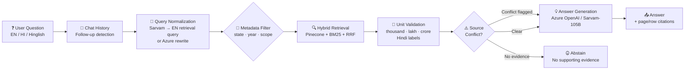

Markdown · civicdatalab-readme.md

# 🏛️ CivicDataLab — Gender Budget RAG

     

**A compact multilingual RAG system over India's Union and state gender-budget corpus — with hybrid retrieval, deterministic numeric validation, Hindi/Hinglish query routing via Sarvam-105B, and strict abstention for unsupported claims.**

---

## 🌐 Platform Overview

| Capability | Description |
| --- | --- |
| **Multilingual Routing** | English → Azure OpenAI; Hindi/Hinglish → Sarvam-105B for query normalization + Hindi answer generation |
| **Hybrid Retrieval** | Pinecone dense similarity + BM25-style lexical ranking fused via Reciprocal Rank Fusion (RRF) |
| **Deterministic Numeric Validation** | Unit conversion guard (thousand / lakh / crore / Hindi labels `हजार लाख करोड़`) with crore-equivalent appending |
| **Source Conflict Detection** | Odisha YoY comparison flags conflicting 15.28% / 18.24% claims instead of silently picking one |
| **Abstention** | Refuses to answer when evidence does not support the requested year, geography, unit, or scheme |
| **Conversation History** | SQLite-backed per-session chat history with follow-up resolution and sidebar management |
| **Evaluation Suite** | 12 gold-labelled dev questions + 18 assignment evaluation questions with JSONL output |

---

## 🏗️ Architecture



---

## 🔄 Query Lifecycle



---

## 🌐 Model Routing

| Question Type | Detection | Query Normalization | Answer Generation |
| --- | --- | --- | --- |
| **English** | Default | Azure OpenAI chat deployment | Azure OpenAI chat deployment |
| **Hindi / Hinglish** | Devanagari script + Hinglish markers | Sarvam-105B → English retrieval query | Sarvam-105B in Hindi |
| **Evaluation rows** | `lang` field (deterministic) | Per-language routing | Per-language routing |
| **Follow-up (EN)** | Conversation history | Azure OpenAI rewrite | Azure OpenAI |
| **Follow-up (HI)** | Conversation history | Sarvam-105B rewrite | Sarvam-105B |

---

## 🚀 Quick Start

```bash
# 1. Create virtual environment
python -m venv .venv

# Windows PowerShell
.venv\Scripts\Activate.ps1
# macOS / Linux
# source .venv/bin/activate

# 2. Install dependencies
pip install -r requirements.txt

# 3. Configure environment
copy .env.example .env   # Windows
# cp .env.example .env   # macOS/Linux
# Edit .env — fill in the keys below

# 4. Build Pinecone index (first time, or after corpus/schema changes)
python -m src.rag ingest --reset

# 5. Launch Streamlit chatbot
streamlit run app.py

# 6. Run dev regression (12 gold-labelled questions)
python -m src.rag dev-eval

# 7. Run assignment evaluation (18 questions → answers.jsonl)
python -m src.rag eval

# 8. Ask a single question via CLI
python -m src.rag ask --question "What was Delhi's Ladli Yojna allocation in 2024-25?"

# 9. Run offline regression tests
python -m unittest discover -s tests
```

---

## ⚙️ Environment Configuration

```env
# Azure OpenAI
AZURE_OPENAI_API_KEY=your_key_here
AZURE_OPENAI_ENDPOINT=https://YOUR_RESOURCE.openai.azure.com/
AZURE_OPENAI_CHAT_DEPLOYMENT=gpt-4o          # deployment name, not model name
AZURE_OPENAI_EMBEDDING_DEPLOYMENT=text-embedding-3-small
# Default API version: 2024-10-21

# Sarvam AI
SARVAM_API_KEY=your_sarvam_key
SARVAM_REASONING_EFFORT=none                  # prevents empty replies from reasoning token budget

# Pinecone
PINECONE_API_KEY=your_pinecone_key
PINECONE_INDEX_NAME=gender-budget
PINECONE_NAMESPACE=default
PINECONE_CLOUD=aws
PINECONE_REGION=us-east-1
```

> ⚠️ Never commit `.env` or paste credentials into GitHub. The SQLite chat database should not be committed if it contains private conversations.

---

## 📂 Document Corpus & Indexing

| Document Type | Indexing Strategy | Source Reference in Answers |
| --- | --- | --- |
| **PDF** | Page-by-page split → overlapping text chunks | `page` number (PDF page) |
| **CSV** | Row-wise indexing, column labels + values preserved | `row` number (header-inclusive) |
| **XLS** | Row-wise via `xlrd`, sheet name retained in metadata | `row` number |

__Metadata stored per chunk:__ `state`, `financial_year`, `scope`, `file`, `page`/`row`, `document_type`

> Pages with no extractable PDF text are skipped (no OCR). Legacy Hindi PDFs with embedded font issues may extract as garbled text — verify manually.

---

## 🔢 Numeric Validation & Retrieval Safeguards

| Safeguard | Description |
| --- | --- |
| **Unit conversion guard** | Validates thousand / lakh / crore conversions; appends crore equivalent when source is in thousand/lakh |
| **Hindi unit labels** | Handles `हजार`, `लाख`, `करोड़` — prevents `Rs 210,000 thousand` from becoming `Rs 210 crore` (correct: `Rs 21 crore`) |
| **Crore-equivalent scoping** | Equivalent appended only when unit is directly attached to source amount — no scanning of arbitrary trailing text |
| **Delhi year-specific routing** | Queries restricted to the PDF whose contents correspond to the requested financial year |
| **KISHORI column selection** | Delhi 2026-27 KISHORI: `402,200` = 2025-26 RE; `300,000 thousand` = 2026-27 Annual Budget Total Outlay (Rs 30 crore) |
| **Kerala abstention** | Corpus has no Kerala gender-budget PDF — Kerala requests abstain rather than re-labelling Odisha figures |
| **Odisha source-conflict guard** | YoY comparison flags conflicting 15.28% / 18.24% claims citing PDF pages 10 and 21 |
| **Mahila Samriddhi Yojana** | Not present in supplied Odisha PDF — unsupported schemes are not guessed |
| **Statement 20 BE 2012-13** | Grand-total row read as Rs 88,142.80 crore; rounded Rs 88,143 crore retained in narrative note |

---

## 💬 Conversation History & Follow-up Resolution

- Chat history stored in `storage/chat_history.sqlite3` — local to the running Streamlit process.
- Sidebar: create, reopen, clear and delete conversations.
- Follow-ups like *"What about the previous financial year?"* or *"Compare that with Bihar"* are rewritten into standalone questions before retrieval.
- The resolved question is shown in the chat UI for transparency.
- Community Cloud: SQLite is not durable across restarts — use PostgreSQL/Supabase for multi-user or persistent deployments.

---

## 📊 Evaluation Output

| Command | Output | Description |
| --- | --- | --- |
| `python -m src.rag dev-eval` | `dev_answers.jsonl` | 12 gold-labelled dev questions with model answer, gold answer, expected source file |
| `python -m src.rag eval` | `answers.jsonl` | 18 assignment evaluation questions in submission format |
| `python -m unittest discover -s tests` | Console | Offline regression: numeric conversion, Hindi labels, KISHORI columns, Odisha conflict guard |

> Inspect answers and citations before submission. Run regression tests before `eval`.

---

## ☁️ Deploy to Streamlit Community Cloud

1. Push `app.py`, `requirements.txt`, `src/`, `tests/`, and `data/` to a GitHub repository root. Commit corpus files (needed for lexical fallback and index rebuilding).
2. Do **not** commit `.env` or `.streamlit/secrets.toml` — paste TOML values into **Advanced settings → Secrets** on Community Cloud.
3. Set entry point to `app.py`; match the local Python minor version (3.13 in current dev environment).
4. **Keep the app private during demo** — SQLite schema is shared across all visitors; index rebuild and evaluation buttons can incur API usage.
5. Replace SQLite with a managed database (PostgreSQL / Supabase) before multi-user or long-term production use.

---

## ⚠️ Known Limitations

| Area | Limitation |
| --- | --- |
| __OCR__ | No OCR performed — pages with no extractable text are skipped |
| __Hindi PDFs__ | Legacy Hindi PDFs with embedded font issues may extract as garbled text |
| __Reranker__ | Lightweight RRF hybrid — not a full BM25 service or cross-encoder reranker |
| __XLS support__ | Read via `xlrd`; malformed files reported and skipped, not silently fabricated |
| __Capture protection__ | Community Cloud SQLite not durable across platform restarts/redeployments |
| __Sarvam empty replies__ | Short structured-output calls retry once with `reasoning_effort=none` on empty `message.content` |

---

## 📚 References

| Resource | Link |
| --- | --- |
| Sarvam AI API Docs | [docs.sarvam.ai/api/token-factory/chat-completions](https://docs.sarvam.ai/api/token-factory/chat-completions) |
| Azure OpenAI Embeddings | [learn.microsoft.com — embeddings](https://learn.microsoft.com/en-us/azure/foundry/openai/how-to/embeddings) |
| Pinecone Serverless | [docs.pinecone.io](https://docs.pinecone.io) |
| pgvector Hybrid / RRF | [github.com/pgvector/pgvector#hybrid-search](https://github.com/pgvector/pgvector#hybrid-search) |

---

**Built by [Alen Thomas](https://github.com/AIstar007) · CivicDataLab Gender Budget Assessment**

[](https://github.com/AIstar007) [](https://linkedin.com/in/alen-thomas-3558bb187/) [](https://portfolio-website-alpha-nine-69.vercel.app/)